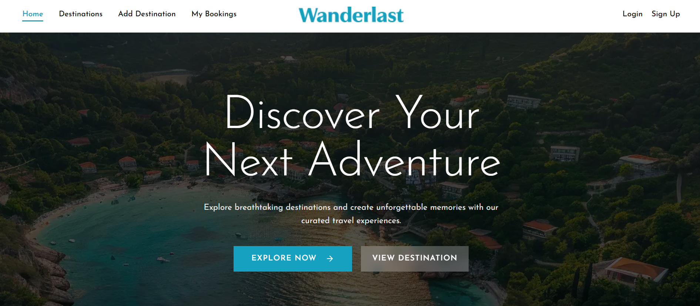

<div align="center">

# 🌍 Wanderlust

### Discover Places. Plan Trips. Create Memories.

A full-stack travel destination and booking web application built with Next.js, Express.js, and MongoDB.

<br />

<a href="https://wanderlust-gamma-pink.vercel.app/">
  
</a>

<br />

<p>
  <a href="https://wanderlust-gamma-pink.vercel.app/">
    <strong>🌐 Live Demo</strong>
  </a>
  &nbsp; • &nbsp;
  <a href="https://github.com/asifdev62/Wanderlust">
    <strong>Frontend Repository</strong>
  </a>
  &nbsp; • &nbsp;
  <a href="https://github.com/asifdev62/wanderlust-server">
    <strong>Backend Repository</strong>
  </a>
</p>

<br />


</div>

</div>

---

## 📖 About The Project

**Wanderlust** is a full-stack travel web application that helps users discover destinations and manage travel bookings through a modern and user-friendly interface.

The application combines a Next.js frontend with an Express.js backend and MongoDB database to handle destination information and booking operations.

This project demonstrates my practical learning experience in full-stack web development, REST API integration, database management, and authentication.

## ✨ Key Features

- 🌍 **Explore Destinations** — Discover travel destinations from different countries.
- 🗺️ **Destination Details** — View destination descriptions, prices, durations, and other information.
- 🧭 **Destination Categories** — Explore destinations by categories such as beaches, mountains, cities, adventure, and culture.
- ➕ **Add Destinations** — Add new destinations to the application.
- 🎫 **Travel Booking** — Submit bookings for selected destinations.
- 👤 **Authentication** — Integrate user authentication with Better Auth.
- 📅 **Booking Management** — Access travel booking information.
- 📱 **Responsive UI** — Enjoy a layout designed for different screen sizes.
- 🔗 **REST API Integration** — Connect the frontend to the backend API.
- 🗄️ **Database Integration** — Store destination and booking information using MongoDB.

## 🛠️ Technologies Used

### Frontend

- Next.js
- React
- TypeScript
- Tailwind CSS
- Better Auth
- Lucide React

### Backend

- Node.js
- Express.js
- MongoDB
- REST API
- dotenv
- CORS

### Tools & Deployment

- Git
- GitHub
- Visual Studio Code
- Vercel

## 🖥️ Application Preview

### Homepage


### Main Application Sections

- **Home** — Explore the travel application.
- **Destinations** — Browse available destinations.
- **Add Destination** — Submit destination information.
- **My Bookings** — Access booking-related information.
- **Authentication** — Sign in or create an account.

## 🌐 Live Application

Visit the deployed application:

### [🚀 Explore Wanderlust](https://wanderlust-gamma-pink.vercel.app/)

## 📂 Project Repositories

| Repository | Description |
|---|---|
| [Wanderlust Frontend](https://github.com/asifdev62/Wanderlust) | Next.js frontend application |
| [Wanderlust Backend](https://github.com/asifdev62/wanderlust-server) | Express.js backend and REST API |

## 🚀 Getting Started

Follow these steps to run Wanderlust locally.

### Prerequisites

Install the following tools:

- Node.js
- npm
- MongoDB
- Git

### 1. Clone the Frontend Repository

```bash
git clone https://github.com/asifdev62/Wanderlust.git
```

Navigate to the frontend directory:

```bash
cd Wanderlust
```

Install dependencies:

```bash
npm install
```

### 2. Configure Frontend Environment Variables

Create a `.env.local` file in the frontend root directory.

Example:

```env
NEXT_PUBLIC_API_URL=http://localhost:5000
```

Make sure the variable name matches the one used in your frontend code. Add any other environment variables required by your authentication configuration.

### 3. Run the Frontend

```bash
npm run dev
```

Open the application:

```text
http://localhost:3000
```

### 4. Clone the Backend Repository

Open a new terminal:

```bash
git clone https://github.com/asifdev62/wanderlust-server.git
```

Navigate to the backend directory:

```bash
cd wanderlust-server
```

Install the dependencies:

```bash
npm install
```

### 5. Configure Backend Environment Variables

Create a `.env` file in the backend root directory.

Example:

```env
PORT=5000
MONGODB_URI=your_mongodb_connection_string
```

Replace `your_mongodb_connection_string` with your MongoDB connection string.

Never commit your actual database credentials or secret keys to GitHub.

### 6. Start the Backend

If your backend defines a `dev` script, run:

```bash
npm run dev
```

Otherwise, use the command configured in the backend's `package.json`. For example, if the entry file is `index.js`:

```bash
node index.js
```

The backend should be available at:

```text
http://localhost:5000
```

## 🔌 API Endpoints

The backend provides the following destination and booking routes.

| HTTP Method | Endpoint | Description |
|---|---|---|
| POST | `/add-destination` | Add a destination |
| GET | `/destination` | Retrieve destinations |
| GET | `/destination/:id` | Retrieve a destination by ID |
| POST | `/booking` | Create a booking |

These endpoints reflect the project's documented API structure. Update the table if the backend routes change.

## 🗄️ Database

Wanderlust uses MongoDB to store application data.

**Database name:** `wanderlast`

**Collections:**

- `destination` — Stores destination information.
- `bookings` — Stores travel booking records.

### Destination Data

Destination information can include:

- Destination name
- Country
- Category
- Price
- Duration
- Departure date
- Image URL
- Description

The exact fields depend on the backend implementation.

## 🔐 Authentication & Security

Wanderlust integrates Better Auth for user authentication.

Security practices:

- Store sensitive configuration in environment variables.
- Never expose database credentials or authentication secrets.
- Configure production environment variables in the deployment platform.
- Validate incoming API requests on the backend.
- Configure CORS for the appropriate frontend origin.
- Protect routes and resources that require authentication.

## 📁 Project Structure

The project uses separate frontend and backend repositories.

### Frontend

```text
Wanderlust/
├── public/
│   └── homepage.png
├── src/
│   ├── app/
│   ├── components/
│   └── lib/
├── .env.local
├── package.json
├── next.config.ts
└── README.md
```

### Backend

```text
wanderlust-server/
├── routes/
├── .env
├── index.js
└── package.json
```

This is an illustrative structure. Your actual folders and files may differ.

## 🔮 Future Improvements

- Advanced destination search and filtering.
- Sorting destinations by price and category.
- Enhanced booking management.
- Booking cancellation functionality.
- User profile management.
- An administrative dashboard.
- Improved loading states and error handling.
- Additional destination images and travel guides.

## 🎯 What I'm Learning

Through this project, I am gaining practical experience with:

- Full-stack web application development.
- Next.js and React.
- Building REST APIs with Express.js.
- Integrating MongoDB.
- Frontend and backend communication.
- Authentication integration.
- Environment configuration.
- Application deployment with Vercel.

## 👨‍💻 Author

### Asif Ali

**Full-Stack Web Developer**

- GitHub: [@asifdev62](https://github.com/asifdev62)
- Frontend: [Wanderlust](https://github.com/asifdev62/Wanderlust)
- Backend: [wanderlust-server](https://github.com/asifdev62/wanderlust-server)
- Live Website: [Wanderlust](https://wanderlust-gamma-pink.vercel.app/)

---

<div align="center">

### ✈️ Discover the World with Wanderlust

*Built with ❤️ by Asif Ali*

</div> -->


### ✈️ Discover the World with Wanderlust

*Built with ❤️ by Asif Ali*

</div>
